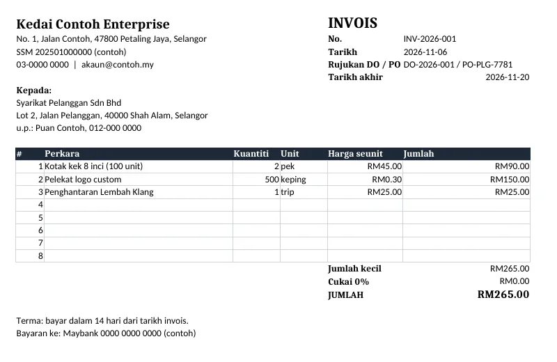

# Templat Invois & Sebut Harga Excel (percuma, Bahasa Melayu)

Templat Excel percuma untuk bisnes kecil di Malaysia: **sebut harga → PO pelanggan → nota penghantaran (DO) → invois → resit**, dengan satu tab **Daftar** yang tunjuk semua dokumen dan jumlah invois yang belum dibayar.

**Muat turun:** [templat-invois-sebut-harga.xlsx](templat-invois-sebut-harga.xlsx) (klik, kemudian butang muat turun). Boleh dibuka dalam Excel, Google Sheets, Numbers atau LibreOffice.

## Apa ada dalam fail
| Tab | Guna untuk |
| --- | --- |
| Cara Guna | Langkah ringkas 1 hingga 6 |
| Tetapan | Isi sekali: nama syarikat, SSM, alamat, bank, kadar cukai, terma bayaran |
| Daftar | Senarai semua dokumen, status, dan jumlah invois belum bayar |
| Sebut Harga | Harga untuk pelanggan, sah 30 hari |
| Nota Penghantaran | Senarai barang yang dihantar (tanpa harga), ruang tandatangan pelanggan |
| Invois | Kira jumlah kecil, cukai dan jumlah, serta tarikh akhir bayaran secara automatik |
| Resit | Bukti bayaran diterima, ikut nombor invois |

## Cara guna
1. Isi tab **Tetapan** sekali sahaja.
2. Pelanggan tanya harga: isi **Sebut Harga**, simpan sebagai PDF, hantar.
3. Pelanggan setuju dan hantar PO: rekod nombor PO mereka dalam **Daftar**.
4. Barang dihantar: isi **Nota Penghantaran**, minta pelanggan tandatangan.
5. Keluarkan **Invois** dan rujuk nombor DO/PO.
6. Duit masuk: keluarkan **Resit** dan tukar status invois kepada *Dibayar*.

Format nombor yang disyorkan: `JENIS-TAHUN-NNN` (contoh `INV-2026-002`). Satu siri untuk setiap jenis dokumen, dan jangan guna semula nombor yang sama.

## Bila Excel dah tak cukup
- Data yang sama ditaip semula di banyak tab atau fail
- Nombor invois bertindih atau terlangkau
- Susah nak nampak siapa belum bayar
- Ramai staf edit fail yang sama

Bila tanda-tanda ini muncul, satu sistem ringkas boleh bawa satu rekod dari sebut harga terus ke invois dan pautan bayaran FPX. Baca lebih lanjut: [Cara buat invoice guna Excel (panduan penuh)](https://miraclemikhael.com/ms/panduan/cara-buat-invoice-guna-excel), [sistem bisnes custom untuk SME](https://miraclemikhael.com/services/custom-business-systems) dan [cara integrate FPX dalam website](https://miraclemikhael.com/ms/panduan/cara-integrate-fpx-website).

## Nota
- Semua nama, alamat dan nombor dalam fail ialah **data contoh**. Gantikan dengan maklumat anda.
- Templat ini bukan nasihat cukai atau perakaunan. Untuk keperluan e-Invois LHDN, rujuk [hasil.gov.my](https://www.hasil.gov.my).
- `bina_templat.py` menjana semula fail Excel ini (Python + openpyxl).

Dibina oleh [Miracle Mikhael](https://miraclemikhael.com), studio web & sistem di Petaling Jaya. Lesen: MIT.
